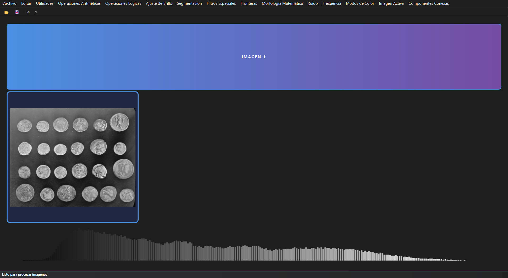

# Image Processing Toolkit

A desktop application for digital image processing, built with Python, OpenCV and PySide6 (Qt). It puts together the techniques from a Digital Image Processing course (B.Eng. in Artificial Intelligence, ESCOM - IPN) in one interface.

You can load up to two images, apply operations from the menus, see the result and the histogram of each image, and undo or redo your steps.



## What it can do

- **Frequency domain:** Fourier transform (magnitude and phase) with low-pass, high-pass and band-pass filters (ideal, Gaussian and Butterworth), and DCT compression with PSNR, MSE and SSIM.
- **Brightness and contrast:** histogram equalization, CLAHE, gamma correction and normalization.
- **Color:** RGB, HSV and CMY channels, grayscale and binarization.
- **Segmentation:** global and adaptive thresholding, Otsu, K-means, watershed and GrabCut.
- **Filters and noise:** mean, median, Gaussian, bilateral and mode filters; salt and pepper, Gaussian, uniform and speckle noise.
- **Morphology:** erosion, dilation, opening, closing, gradient, top-hat and black-hat.
- **Edges:** Canny edge detector.
- **Connected components:** labeling, coloring and properties of each component.
- **Arithmetic and logic operations** between images: add, subtract, multiply, divide, blend, AND, OR, XOR and NOT.

## How to run

```bash
pip install -r requirements.txt
python main.py
```

## Project structure

```
main.py                  starts the application
config.py                default parameters
src/
  fourier/               Fourier transform and DCT
  procesamiento_basico/  brightness, thresholding, segmentation
  procesamiento_avanzado/ filters, noise, morphology, Canny, connected components
  operaciones/           arithmetic and logic operations
  utilidades/            image loading and channel analysis
  interfaces/            the Qt interface, one file per menu section
```

The processing code does not depend on the interface, so the classes in `src/` can also be used from your own scripts. Menu labels and code comments are in Spanish, as in the original coursework.

## Technologies

Python, OpenCV, NumPy, SciPy, Matplotlib, Pillow, PySide6

## Credits

Alberto Gomez Mendez and Fernanda Trujillo Rodriguez, together with the course team "Comunidad 2": Sofia Mena Fernandez, Rodrigo Monroy Pastrana, Einnar Zein Salas Juarez and Ethan Axel Yañez Torres.

The example image in the screenshot is the public domain `coins` sample from scikit-image.
